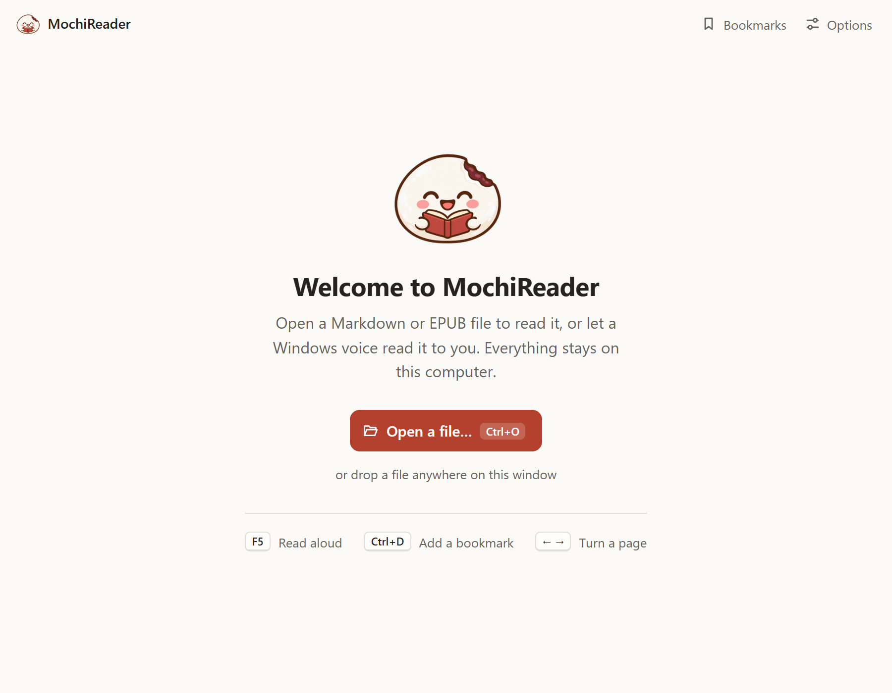
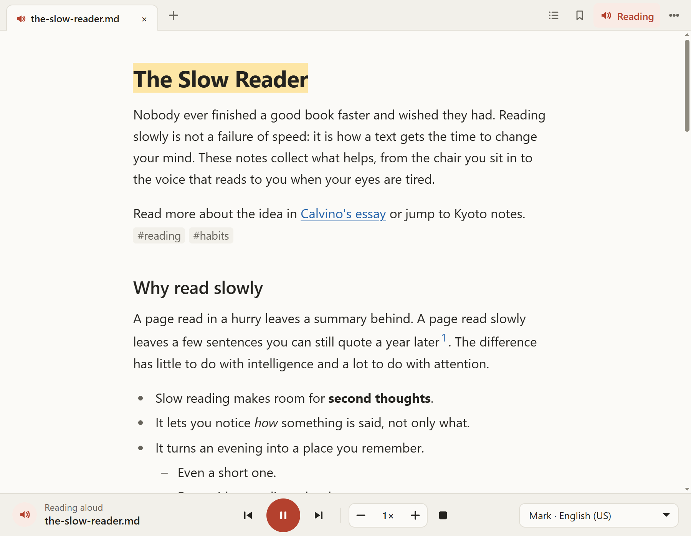
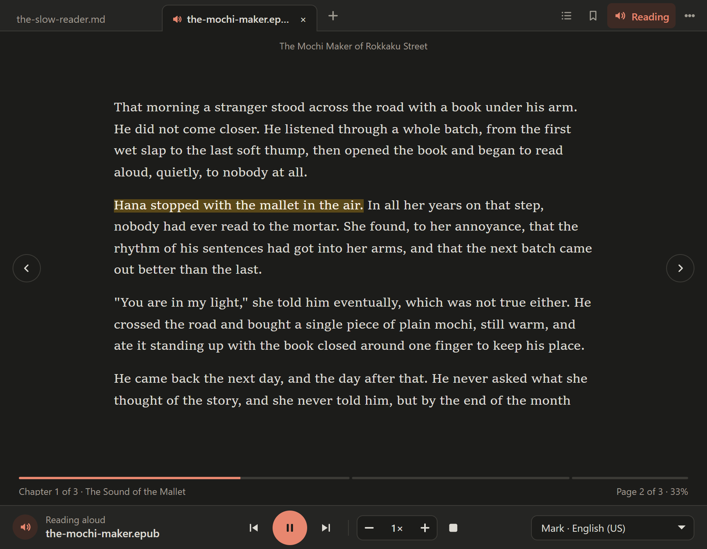
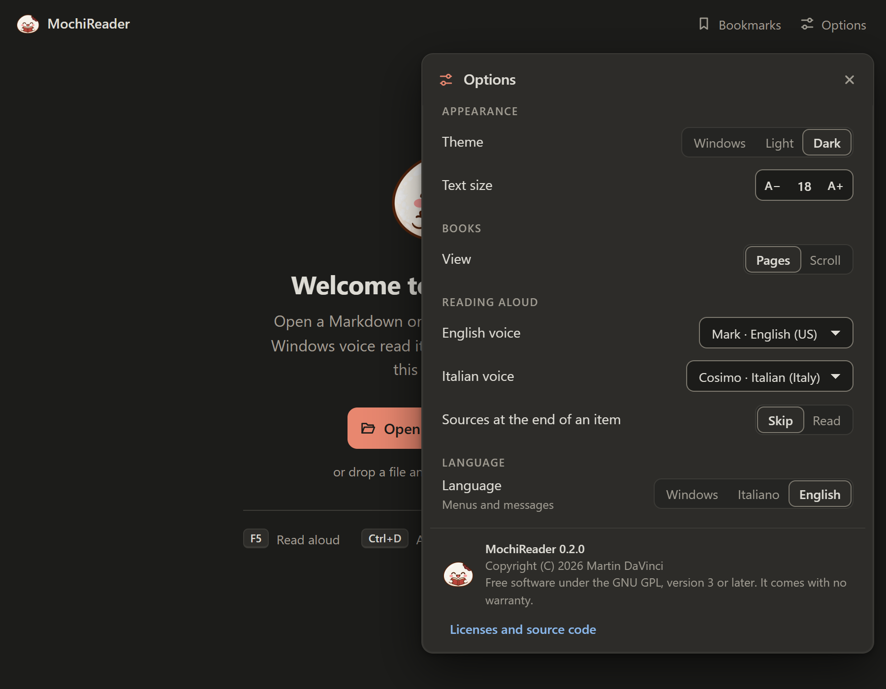

<p align="center">
  
</p>

<h1 align="center">MochiReader</h1>

<p align="center">A calm Windows reader for Markdown and EPUB, which can read aloud with the voices already in Windows. Entirely offline.</p>

<p align="center">
  <a href="https://github.com/martindavinci/MochiReader/actions/workflows/ci.yml"></a>
  <a href="https://github.com/martindavinci/MochiReader/releases/latest"></a>
  <a href="LICENSE"></a>
  
</p>

<p align="center">
  
</p>

Double-click a file and read it, or have it read aloud. Nothing leaves your computer.

## Features

- Opens `.md`, `.markdown` and `.epub` files in tabs, and reopens each one where you stopped. The recent files show the chapter a book was left at.
- Reads aloud with the Windows voices, sentence by sentence, highlighting the sentence and following it down the page. It goes on with the window minimised.
- Skips what sounds wrong when spoken: link addresses, source citations and frontmatter.
- Remembers the last voice used for each language.
- Books show their chapter, page and progress, with arrows to turn the page, in pages or in one long scroll.
- Table of contents, bookmarks with undo, and recent files, each a click away beside the tabs.
- Light and dark themes, or the one Windows uses. Nine languages: English, Italian, German, Spanish, French, Portuguese (Brazil), Japanese, Korean and Simplified Chinese. Every action has a key, and F1 lists them.
- The speed and the volume of the voice from the reading bar, kept between sessions.

<p align="center">
  
  &nbsp;
  
</p>

<p align="center">
  
</p>

## Install

Download `MochiReader_<version>_x64-setup.exe` from the [releases](https://github.com/martindavinci/MochiReader/releases) page and run it. It installs for the current user, so it does not ask for administrator rights. If WebView2 is missing, the installer downloads it.

For a copy that leaves nothing on the computer, download `MochiReader-<version>-windows-x64-portable.zip` instead, extract it anywhere you can write to, and run `MochiReader.exe`. Its settings, bookmarks and positions stay in the `data` folder beside it. It does not register itself for `.md` and `.epub` files.

The installer is not signed, so Windows SmartScreen may warn you. Choose "More info", then "Run anyway".

### Make it the default app

The installer registers MochiReader for `.md`, `.markdown` and `.epub`. Windows may still ask you to confirm: right-click a file, choose "Open with", then "Choose another app", select MochiReader and tick "Always use this app".

### Add a voice

MochiReader uses the voices installed in Windows and never sends text anywhere. To add one, open Settings, Time & Language, Speech, and choose "Add voices". If the app tells you a language has no voice, it also explains what to do.

## Keyboard

| Keys | Action |
| --- | --- |
| `Ctrl+O` | Open a file |
| `Ctrl+W` / `Ctrl+Tab` | Close the tab / next tab |
| `F5` or `Ctrl+Shift+S` | Read aloud |
| `Space` | Pause and resume, while reading |
| `Left` / `Right` | Previous / next sentence, while reading |
| `Shift+Left` / `Shift+Right` | Previous / next block |
| `Ctrl+Left` / `Ctrl+Right` | Previous / next section |
| `+` / `-` | Read faster / slower |
| `Ctrl++` / `Ctrl+-` | Bigger / smaller text |
| `Ctrl+D` | Add or remove a bookmark |
| `Ctrl+B` / `Ctrl+T` / `Ctrl+R` | Bookmarks / table of contents / recent files |
| `Ctrl+,` | Options |
| `F1` | All the shortcuts |

## Build from source

You need Rust 1.90 or later, Node 24 and `tauri-cli` 2.12.3.

```
npm ci
cargo tauri build
```

The installer lands in `src-tauri/target/release/bundle/nsis/`.

## Release

1. Set the same version in `package.json`, `src-tauri/Cargo.toml` and `src-tauri/tauri.conf.json`, and add it to `CHANGELOG.md`.
2. Commit, then push a tag named `v<version>`.

GitHub Actions runs the tests, builds the installer and creates a draft release with it. Publish the draft when you are happy with it.

## License

GPL-3.0-or-later, see [LICENSE](LICENSE). The name "MochiReader", the name "Martin DaVinci" and the MochiReader logo and mascot are not licensed as trademarks: a modified version you distribute needs a different name and a different icon, see [TRADEMARKS.md](TRADEMARKS.md).

The licenses of MochiReader and of everything distributed with it are in [app/licenses.txt](app/licenses.txt). In the app, open Options with Ctrl+, and choose "Licenses and source code". The installer also puts the same text in `licenses.txt`, in the folder where it installs the app.
